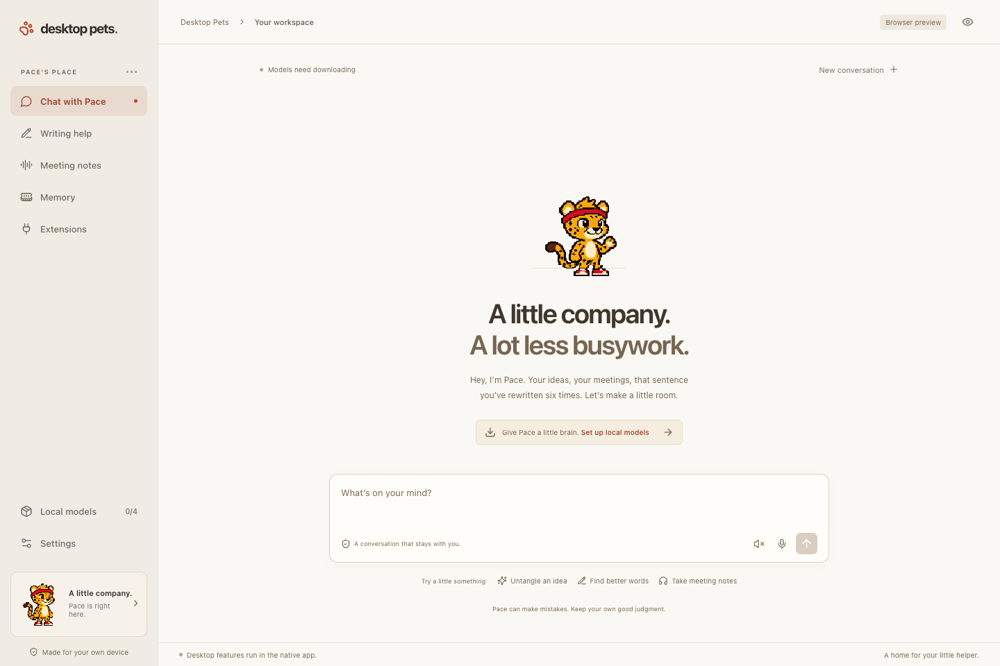

# Desktop Pets

**A little desktop friend that helps you get things done.**

Pace is a playful pixel cheetah with a local brain: chat, multilingual voice, writing help, opt-in work memory and meeting notes. The app starts with twelve original sprite actions and a format for community pets.

This is an early **Apple Silicon Mac** release targeting **macOS 15+ and 16 GB RAM**. The Tauri shell and native capability boundary are designed for future Windows/Linux ports; those ports are not implemented yet.

[Mac alpha download](https://github.com/RebZJ/desktop-pets/releases/tag/v0.1.0-alpha.2) · [Pace sprite starter](https://github.com/RebZJ/desktop-pets/releases/download/v0.1.0-alpha.2/Pace-starter.zip). The installer is ad-hoc signed and not Apple-notarized.



## What Pace can do

- Live on your desktop, react to petting, sleep, celebrate, move with a drag and hide/return with a shortcut.
- Chat using a local Qwen3.5 model and speak through Qwen3-TTS. English, Mandarin, Japanese and Spanish are the initial validation languages.
- Rewrite selected text, draft replies and turn dictated speech into text. Review before applying; stale or unsupported editing targets fall back to copying.
- Remember readable text from explicitly allowed foreground native applications. Memory starts off, stays local and has search/delete controls. Browser background capture is intentionally disabled until private-mode boundaries can be verified; manually selected browser text can still be used for writing.
- Capture microphone and selected-app/system audio only after Start, transcribe locally, separate anonymous speakers, produce editable notes/actions and offer quiet text tips. Rename speaker labels yourself; diarization does not identify real people.
- Import and activate declarative pet packs, and connect explicitly configured local MCP programs with per-tool grants and reviewed arguments.

Core inference works without a network after model installation. There is no required account, subscription or cloud inference. Optional local MCP programs are third-party software and can have their own network access.

## Run from source

Install Node.js 22+, Rust 1.90+, full Xcode with Swift 6.2+, and CMake on an Apple Silicon Mac. Select the full Xcode developer directory. The first native build downloads pinned dependencies and may install Apple's missing Metal Toolchain component.

```sh
npm ci
npm run native:build
npm run desktop
```

Open **Local models** to install the models you need. The complete pack is approximately **5.7 GB** of downloads; the sprite artwork itself is around 80 KB. Interrupted downloads can be retried, and files are checked against pinned manifests and checksums. Models are not committed to this repository.

| Model | Job | Download |
| --- | --- | --- |
| Qwen3.5 4B, uniform MLX 4-bit | Chat, writing, notes and tips | 3.06 GB |
| Qwen3-TTS 0.6B CustomVoice, MLX 8-bit | Multilingual voice | 1.97 GB |
| Whisper large-v3-turbo Q5 | Transcription and dictation | 574 MB |
| Nemotron-3 Diarization Q8 | Speaker labels | 107 MB |

The native worker bundles MLX Swift, whisper.cpp and NeMo-Speech.cpp. Users of the packaged app do not install Python, Ollama, developer tools or a separate model server.

`npm run dev` opens a browser preview of the interface. Browser preview does not provide native audio, Accessibility or inference and reports that limitation instead of simulating an assistant.

## Your first session

On first launch, Pace’s pixel campsite introduces the companion in four stops: Meet, Pack, Access and Home. Model downloads and macOS access are optional; choose **Skip adventure** to enter the workspace. Replay it anytime from **Settings → A little adventure → Replay Pace’s adventure** without resetting your preferences.

1. Download the models, then send Pace a message.
2. In Settings, review Accessibility for writing, Microphone for dictation, and Screen & System Audio for meeting capture. Development and packaged apps may receive different macOS permission identities.
3. Select text in another app and press **Option–Space** to open writing help. Preview a revision and choose Apply or Copy.
4. Press **Option–Shift–Space** to hide/show Pace. The menu bar also opens the workspace and restores the pet. Both shortcuts are configurable.
5. For notes, choose the meeting audio application and click Start meeting. Prefer headphones to reduce microphone/system echo. Pace remains silent while recording.

Hiding the windows does not stop a recording. The menu bar retains its recording indicator. macOS does not provide reliable exclusion from every full-display screen capture; share a selected app window or hide Pace when needed. This app makes no universal invisibility promise.

## Data and permissions

Local data lives under `~/Library/Application Support/Desktop Pets`: the SQLite database, model files, generated audio and temporary meeting recordings. The application directory is restricted to the current account. It uses local filesystem protection; it does not add a separate encrypted vault.

Ambient memory is off by default and retains enabled-app observations for 30 days by default. Saved meeting transcripts remain until deleted. Raw meeting audio is removed after successful finalization; interrupted recordings are retained for recovery. Captured material never changes tool permissions and is treated as untrusted source text. Model responses can still be wrong; review notes and actions against the transcript.

## Tests

```sh
npm run build
npm test
npm run test:rust
swift test --package-path native/PaceNative -c release -j 6
python3 native/scripts/test-inference.py
```

The inference check requires the installed model pack and verifies actual local generation under a macOS network-denying sandbox. Browser contract tests use clearly labelled synthetic fixtures. See [native validation](docs/native-validation.md) and [release validation](docs/validation.md) for the tested scope and remaining hardware checks.

Generate a labelled two-speaker audio fixture without recording a microphone:

```sh
python3 scripts/create-meeting-fixture.py
bash native/scripts/test-diarization.sh "$PWD/artifacts/runtime/meeting-fixture/meeting.wav"
```

## Build and extend

```sh
npm run native:build
python3 scripts/collect-runtime-licenses.py
npm run tauri -- build --bundles app --no-sign
python3 scripts/package-pet.py
bash scripts/package-macos.sh
```

Local/ad-hoc builds are not notarized releases. Public installers need a Developer ID signing and notarization setup. Native build resources and third-party notices must travel with the helper.

- [Create a pet pack](docs/pet-packs.md)
- [Model research and selection](docs/model-selection.md)
- [Native architecture and development](native/README.md)
- [Contribute](CONTRIBUTING.md)
- [Distribution experiments](docs/distribution.md)

Code is **MIT**. Original Pace artwork is **CC BY 4.0**, credited to Outpaced / Desktop Pets. Model and runtime licenses remain separate; see [NOTICE](NOTICE.md).
