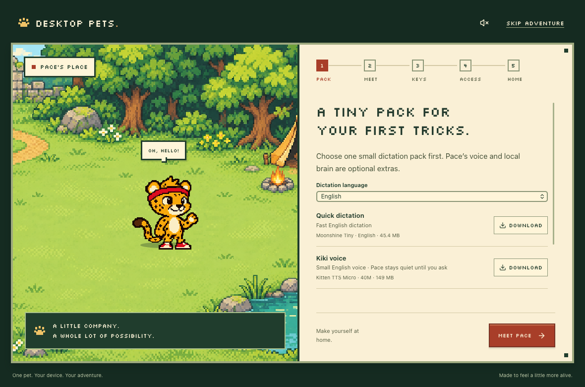
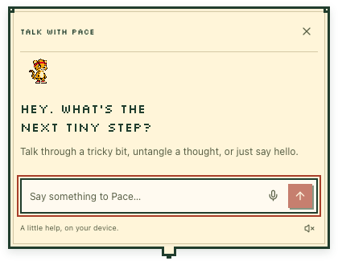

# Desktop Pets

**A little desktop friend that helps you get things done.**

Pace is a playful pixel cheetah with a local brain: short conversations, Kiki’s voice, global dictation, cursor autocomplete, opt-in work memory and meeting notes. The app includes fifteen sprite actions and a format for community pets.

This is an early **Apple Silicon Mac** release targeting **macOS 15+ and 16 GB RAM**. The Tauri shell and native capability boundary are designed for future Windows/Linux ports; those ports are not implemented yet.

[Previous Mac alpha download](https://github.com/RebZJ/desktop-pets/releases/tag/v0.1.0-alpha.2) · [Pace sprite starter](https://github.com/RebZJ/desktop-pets/releases/download/v0.1.0-alpha.2/Pace-starter.zip). The installer is ad-hoc signed and not Apple-notarized. The source below contains the newer companion flow; its public installer is held while granted-access native checks finish.





## What Pace can do

- Live quietly on your desktop. Hover Pace to reveal a little weapon selector beneath him, with responsive slots for Talk, Dictate and Write for me. Pet him, drag him, or hide/return with a shortcut.
- Open a small Talk cloud beside Pace, using local Qwen3.5 4B and the chosen **Kiki** voice from KittenTTS. Qwen3-TTS remains optional for multilingual voice.
- Dictate into the app you are using. Pace’s big cartoon ear shows when the microphone is on; press the shortcut again to finish. Smaller Moonshine packs handle explicit English, Chinese, Japanese or Spanish dictation; Whisper handles Auto and meetings.
- Hover Pace and choose **Write for me** beneath him for a short continuation at your cursor. Review/edit it, then Accept, Copy or Dismiss. It captures nearby field text and optional writing examples; it does not continuously watch your typing. Changed or unsupported fields keep a copyable result.
- Remember readable text from explicitly allowed foreground native applications. Memory starts off, stays local and has search/delete controls. Browser background capture is intentionally disabled until private-mode boundaries can be verified; manually selected browser text can still be used for writing.
- Capture microphone and selected-app/system audio only after Start, transcribe locally, separate anonymous speakers, produce editable notes/actions and offer quiet text tips. Rename speaker labels yourself; diarization does not identify real people.
- Import and activate declarative pet packs, and connect explicitly configured local MCP programs with per-tool grants and reviewed arguments.

Core inference works without a network after model installation. There is no required account, subscription or cloud inference. Optional local MCP programs are third-party software and can have their own network access.

## Run from source

Install Node.js 22+, Rust 1.90+, full Xcode with Swift 6.2+, and CMake on an Apple Silicon Mac. Select the full Xcode developer directory. The first native build downloads pinned dependencies and may install Apple's missing Metal Toolchain component.

```sh
npm ci
npm run native:build
npm run desktop
```

Onboarding starts with model setup. A dictation-only start needs about **45 MB** for English or **32 MB** for each other supported language. Add **149 MB** for Kiki’s voice and **3.06 GB** for local chat/autocomplete. Meeting and multilingual voice models are optional. Interrupted downloads can be retried; pinned manifests and checksums verify the files. Models are not committed to this repository or bundled in the installer.

| Model | Job | Download |
| --- | --- | --- |
| Qwen3.5 4B, uniform MLX 4-bit | Chat, writing, notes and tips | 3.06 GB |
| KittenTTS Micro 0.8, native MLX | English voice; Kiki default | 149 MB including pronunciation assets |
| Moonshine Tiny, native ONNX | Fast dictation; separate EN/ZH/JA/ES packs | 45.4 MB EN; about 32 MB each other |
| Qwen3-TTS 0.6B CustomVoice, MLX 8-bit | Optional multilingual voice | 1.97 GB |
| Whisper large-v3-turbo Q5 | Meeting transcription; Auto dictation fallback | 574 MB |
| Nemotron-3 Diarization Q8 | Speaker labels | 107 MB |

The native worker bundles MLX Swift, Moonshine, whisper.cpp and NeMo-Speech.cpp. Users of the packaged app do not install Python, Ollama, developer tools or a separate model server.

`npm run dev` opens a browser preview of the interface. Browser preview does not provide native audio, Accessibility or inference and reports that limitation instead of simulating an assistant.

## Your first session

On first launch, Pace’s pixel campsite guides five stops: Pack, Meet, Keys, Access and Home. Download only what you need, choose shortcuts, and try them in setup. Access, recording and voice previews require explicit actions. Replay the adventure from Settings without resetting preferences.

| Action | Default shortcut |
| --- | --- |
| Talk beside Pace | Option–Space |
| Start/finish global dictation | Option–Shift–D |
| Preview autocomplete at the cursor | Option–Shift–Return |
| Quick hide/show | Option–Shift–Space |

macOS access is granted to the app’s signature. When replacing an ad-hoc development build, a checked Accessibility switch may still reference the older signature. If fresh requests remain denied after restarting, remove only Desktop Pets from the Accessibility list and add the installed app again. A stable Developer ID release is needed to improve this update experience.

All four shortcuts are editable, checked for conflicts, and practiced in onboarding. Add names or specialist words under Dictation vocabulary; these reach the decoder as hints, not guaranteed spelling. Optional writing examples guide autocomplete without enabling ambient memory.

For meetings, choose the audio application and click Start meeting. Prefer headphones to reduce microphone/system echo. Pace stays silent during recording. Hiding Pace stops dictation; meeting recording keeps its menu-bar indicator. Content protection is applied to every app window and passed a controlled full-display screenshot/live-stream probe on the tested Mac. It remains **best effort** across macOS and sharing applications; Quick Hide is available and no universal invisibility is promised.

## Data and permissions

Local data lives under `~/Library/Application Support/Desktop Pets`: the SQLite database, model files, generated audio and temporary meeting recordings. The application directory is restricted to the current account. It uses local filesystem protection; it does not add a separate encrypted vault.

Ambient memory is off by default and retains enabled-app observations for 30 days by default. Saved meeting transcripts remain until deleted. Raw meeting audio is removed after successful finalization; interrupted recordings are retained for recovery. Captured material never changes tool permissions and is treated as untrusted source text. Model responses can still be wrong; review notes and actions against the transcript.

## Tests

```sh
npm run build
npm test
npm run test:rust
npm run native:test
python3 native/scripts/test-inference.py
```

The inference check requires the installed model pack and verifies actual local generation under a macOS network-denying sandbox. Browser contract tests use clearly labelled synthetic fixtures. See [native validation](docs/native-validation.md) and [current companion validation](docs/companion-validation-2026-11-13.md) for the tested scope and remaining hardware checks.

Generate a labelled two-speaker audio fixture without recording a microphone:

```sh
python3 scripts/create-meeting-fixture.py
bash native/scripts/test-diarization.sh "$PWD/artifacts/runtime/meeting-fixture/meeting.wav"
```

## Build and extend

```sh
npm run native:build
python3 scripts/collect-runtime-licenses.py
npm run tauri -- build --bundles app --no-sign
python3 scripts/package-pet.py
bash scripts/package-macos.sh
```

Local/ad-hoc builds are not notarized releases. Public installers need a Developer ID signing and notarization setup. Native build resources and third-party notices must travel with the helper.

- [Create a pet pack](docs/pet-packs.md)
- [Measured model comparisons](docs/snappy-models-research-2026-11-13.md)
- [Dictation, capture privacy and tiny-model research](docs/dictation-privacy-research-2026-11-13.md)
- [Model selection](docs/model-selection.md)
- [Native architecture and development](native/README.md)
- [Contribute](CONTRIBUTING.md)
- [Distribution experiments](docs/distribution.md)

Code is **MIT**. Original Pace artwork is **CC BY 4.0**, credited to Outpaced / Desktop Pets. Model and runtime licenses remain separate; see [NOTICE](NOTICE.md).
